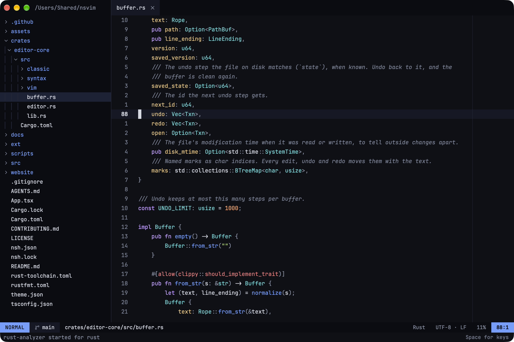
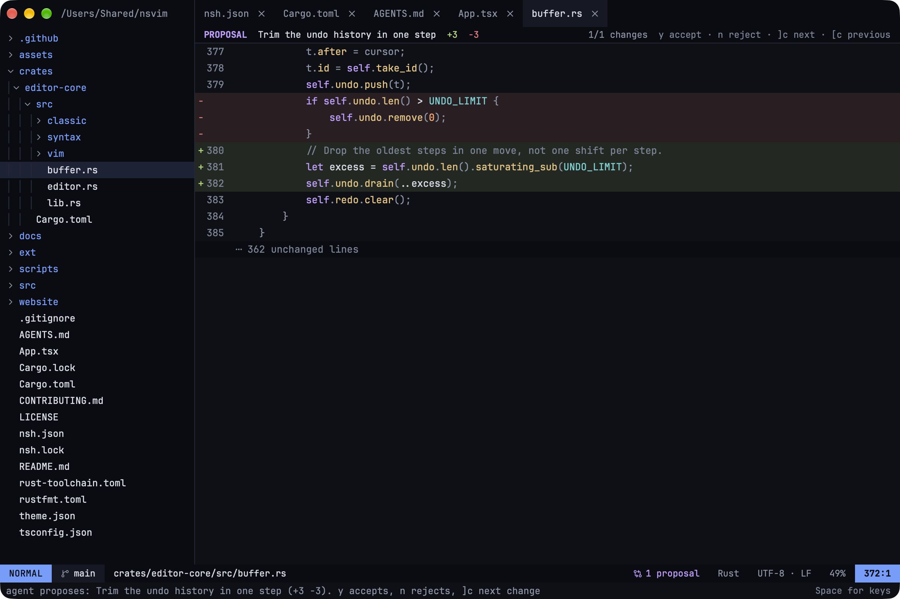
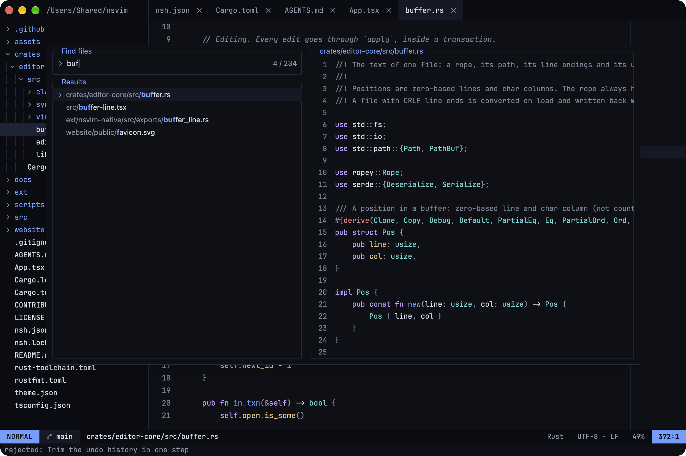
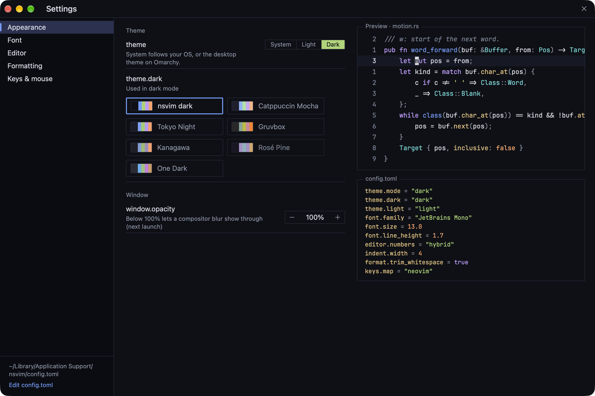
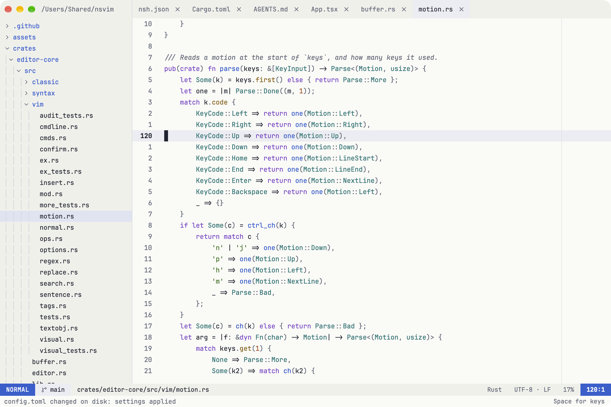

<div align="center">


# nsvim

**A modal code editor with Vim keys, drawn with the native views of each platform.**

[Website](https://huacnlee.github.io/nsvim/) · [Install](#install) · [Keys](docs/keymaps.md) · [Configuration](docs/configuration.md) ·
[AI agents](docs/agents.md) · [How it works](docs/architecture.md)

</div>



## The name

nsvim has two meanings:

- **N**ext **S**imple **VIM**: a small, fast editor with the Vim keys you know.
- **N**ative **S**hell **VIM**: it draws its UI with [NSH (Native Shell)](https://nsh.dev).

## Where it comes from

nsvim is a fork of [editor](https://github.com/bjarneo/editor) by
[Bjarne Oeverli](https://github.com/bjarneo) and its contributors, under the MIT license. The
git history keeps their work, and [LICENSE](LICENSE) keeps their copyright.

nsvim is a separate project. It does not follow editor's releases, and its changes do not go
back to editor. Report nsvim issues here, not to editor.

The main change: nsvim draws its UI with [NSH](https://nsh.dev), which uses the native views of
each platform (GTK 4 on Linux, AppKit on macOS, WinUI on Windows). The screens are
[`App.tsx`](App.tsx) and [`src/`](src). The app's Rust is in [`ext/nsvim-native`](ext/nsvim-native). The editing core (buffer, Vim and classic keymaps, tree-sitter) is the crate
`editor-core` in [`crates/editor-core`](crates/editor-core).

## What it is

nsvim is for opening code, reading it, finding your way around it and making quick edits.

- **Real Vim, or classic keys.** Counts, operators, text objects, dot repeat, registers,
  macros, marks and Visual block. Or no modes at all, with multiple cursors. Pick one at first
  launch and switch any time.
- **Code-aware.** Tree-sitter text objects (`af`, `ic`, `ia`) and motions (`]f`, `[c`) in 13
  languages. LSP with diagnostics, go to definition, references, hover, completion, rename and
  code actions, from the servers you have installed.
- **Find anything.** A fuzzy file finder, project search through ripgrep, a file tree with git
  status, and a list of every key with search: `F1`.
- **Works with your AI agent.** No AI inside. Claude Code, Codex or any CLI agent sees what you
  look at and drives nsvim over its `mcp` or `ctl` command. It reads your selection and unsaved
  text, points you at code, and proposes changes that you accept with `y`.
- **Safe.** Crash recovery, undo that survives a restart, changed lines marked when a git
  checkout or an agent changes a file, and atomic saves.
- **Yours.** 16 themes. On [Omarchy](https://omarchy.org), the System look follows the desktop
  theme live. Any monospace font. Settings writes each change to `config.toml` at once.

## Screenshots

<table>
  <tr>
    <td width="50%"></td>
    <td width="50%"></td>
  </tr>
  <tr>
    <td>An agent proposes a change. Press <code>y</code> to accept it or <code>n</code> to reject it.</td>
    <td>Find a file with <code>SPC f</code>. The preview shows the selected file.</td>
  </tr>
  <tr>
    <td width="50%"></td>
    <td width="50%"></td>
  </tr>
  <tr>
    <td>Settings shows a live preview and the <code>config.toml</code> that it writes.</td>
    <td>The light theme. The System look follows your OS.</td>
  </tr>
</table>

## Install

nsvim runs on macOS 14 or later (Apple silicon and Intel), Linux x86_64 and ARM64 with GTK 4.14
or later, and Windows x86_64.

**macOS / Linux**

```sh
curl -fsSL https://huacnlee.github.io/nsvim/install.sh | sh
```

**Windows PowerShell**

```powershell
irm https://huacnlee.github.io/nsvim/install.ps1 | iex
```

**From source**

The program reads its interface from `nsh/bundle.nshc` next to it, so `cargo install` alone does
not make a program that runs. Build with Rust and the [NSH CLI](https://nsh.dev/docs/installation)
0.7. On Linux, the build also needs the GTK 4 development packages.

```sh
git clone https://github.com/huacnlee/nsvim && cd nsvim
cargo build --release --locked
nsh build --release -o target/release/nsh   # on macOS: -o target/Resources/nsh
target/release/nsvim .                      # the first launch sets up nvim
```

[docs/install.md](docs/install.md) tells how to pick a version or a folder, upgrade and uninstall.

## Quick start

```sh
nvim .                  # this folder as the project
nvim src/main.rs:42     # a file, at line 42
```

The installer puts the command `nsvim` on `PATH`. Open nsvim the first time from the app launcher, or
with `nsvim .` in a terminal. The first launch runs a five-step setup: keys, mouse, look,
terminal and ready. The terminal step adds shell aliases, so `nvim`, `vim` and `vi` open nsvim
(on by default). `\nvim` still runs Neovim. The step also sets `$EDITOR` and git's editor to
nsvim's full path. On Linux, it can make nsvim the default app for text files. It shows every
command before it runs, and it runs only the ones you leave on.

## Keys

| Action | Neovim | Classic |
| --- | --- | --- |
| Save | `:w` | `Ctrl S` |
| Go to file | `SPC f` | `Ctrl P` |
| Find in project | `SPC /` | `Ctrl ⇧ F` |
| Command line | `:` | |
| Command palette | | `Ctrl ⇧ P` |
| Every key, with search | `SPC ?`, `F1` | `F1` |
| Leader keys, in a popup | `SPC` | |
| Go to definition | `gd` | `F12` |
| Rename symbol | `SPC l n` | `F2` |
| Select a function | `vaf` | |
| Next function | `]f` | |
| Add a cursor at the next match | | `Ctrl D` |
| Focus the file tree | `SPC e` | `Ctrl ⇧ E` |
| Settings | `:Settings` | `Ctrl ,` |

On macOS, `⌘` replaces `Ctrl` in the classic keymap. [docs/keymaps.md](docs/keymaps.md) has
every key.

## Configuration

Settings covers the window. Open it with `:Settings` or `SPC ,` in the Neovim keymap, or with
`Ctrl ,` in the classic keymap. Every change applies at once and is written to
`~/.config/nsvim/config.toml`. [docs/configuration.md](docs/configuration.md) lists every option.

## AI agents

Agents and scripts do not see shell aliases, so they run nsvim by its full path. `nvim --help`
prints it. On Linux, the installer puts it at `~/.local/share/nsvim/nsvim`:

```sh
claude mcp add nsvim -- ~/.local/share/nsvim/nsvim mcp     # Claude Code: nsvim as tools
~/.local/share/nsvim/nsvim ctl state                       # any agent or script: what you look at
nvim ctl reveal src/main.rs:10-14 --note "this is the bug"  # in your own shell, the alias works
```

[docs/agents.md](docs/agents.md) has the setup for Claude Code, Codex and opencode.

## Development

The core and all app state are Rust (`crates/editor-core`, `ext/nsvim-native`). The screens are TSX
(`App.tsx`, `src/`) on [NSH](https://nsh.dev).

```sh
nsh run                                       # the app in a window
nsh check && nsh build                        # types, the crate and the TSX bundle
TMPDIR=~/.cache/nsvim-test-tmp cargo test
cargo clippy --all-targets -- -D warnings
```

Read [AGENTS.md](AGENTS.md), [docs/architecture.md](docs/architecture.md) and
[docs/development.md](docs/development.md) before you change the code.

## Contributing

Read [CONTRIBUTING.md](CONTRIBUTING.md). It says what fits nsvim, how to name commits and pull
requests, and what to run first.

## License

nsvim is released under the MIT license. See [LICENSE](LICENSE).

nsvim is based on [editor](https://github.com/bjarneo/editor), the original work of
[Bjarne Oeverli](https://github.com/bjarneo) and its contributors, also under the MIT license.
Their copyright notice stays in [LICENSE](LICENSE), as the license asks. The editing core, the
keymaps, the tree-sitter support, the agent socket and much of the design come from their work.
Thank you to them.

- Copyright (c) 2026 The editor authors: the original work.
- Copyright (c) 2026 Jason Lee and the nsvim contributors: the changes in nsvim.

If you copy or change nsvim, keep both copyright lines and the license text.
