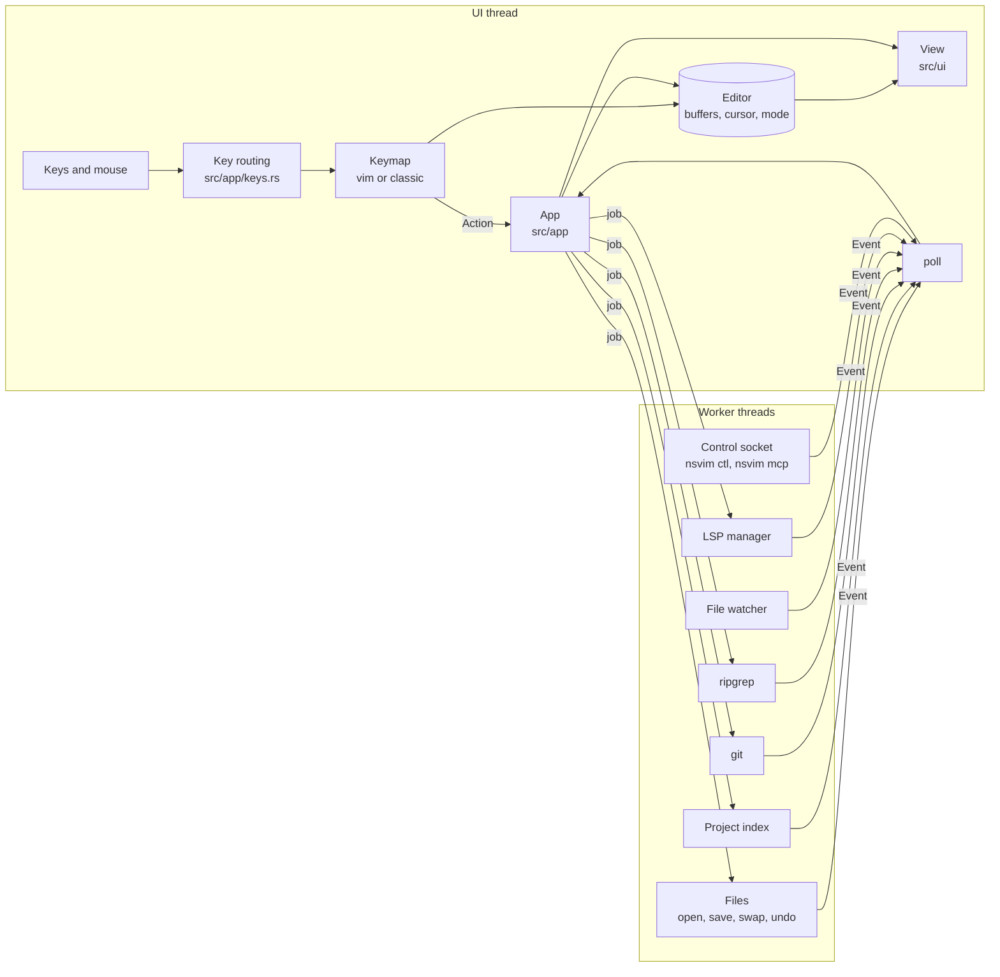

# How editor works

editor is two crates in one package. The **core** (`src/lib.rs`) is the text and the rules for
changing it. It knows nothing about windows. The **app** (`src/main.rs`) draws the core with
Rune, routes input to it, and runs every slow job on a worker thread.



## The core: `src/lib.rs`

| Module | Holds |
| --- | --- |
| `buffer` | `Buffer`: a [ropey](https://docs.rs/ropey) rope, the path, line endings, grouped undo, named marks that move with edits, and the undo history kept across restarts. |
| `editor` | `Editor`: open documents, the active one, the mode, registers, the command line, search, options, and the `Action`s a keymap returns. |
| `vim` | The Neovim keymap: Normal, Insert, Replace, Visual and Command modes, operators, motions, text objects, Ex commands, search and a small regex engine. |
| `classic` | The classic keymap: no modes, Shift to select, Ctrl or ⌘ shortcuts, and multiple cursors. |
| `syntax` | Tree-sitter text objects and motions for 13 languages. |

A keymap is a function from a key to changes:

```rust
pub fn handle_key(ed: &mut Editor, key: KeyInput) -> Vec<Action>
```

It changes the text and the cursor directly. Anything outside the text, such as saving a file,
opening the finder or copying to the system clipboard, comes back as an `Action` for the app to
carry out. That split keeps the core free of I/O, so its 139 tests run in milliseconds and need
no GPU.

Every edit goes through `Buffer`, inside a transaction:

```rust
buf.begin(cursor);
buf.remove(a, b);
buf.insert_at(a, "new text");
buf.commit(cursor); // one undo step, with the cursor before and after
```

An Insert session, a `:s` command, a paste at every cursor or a rename across a file is one
undo step.

## The app: `src/main.rs`

| Folder | Holds |
| --- | --- |
| `src/app` | `App`, the state Rune renders: the core `Editor`, the tree, overlays, Settings, setup, git and LSP state. Key routing, mouse handling, pickers and actions. |
| `src/ui` | Views. Each is a function from `&App` to a Rune element tree. |
| `src/services` | The worker threads, each with a job channel in and an `Event` channel out. |
| `config.rs`, `theme.rs` | `config.toml`, the 16 built-in palettes, and the Omarchy theme reader. |
| `highlight.rs`, `fuzzy.rs` | Syntax colours from Rune's lexers, and fuzzy ranking for pickers. |

### One frame

Rune calls `view(&App)` whenever state changes. The view builds only what is on screen: the
visible lines of the active buffer, the visible rows of the tree and the picker. A line is one
text element with coloured spans. Selections and search matches are paint-only highlights, so
they never reshape text. Scrolling is the editor's own (`view.top`), not a Rune scroll view,
because the cursor and `scrolloff` decide what shows.

The whole view uses `instant_changes()`, and each key handler calls `tx.instant()`. Text, the
cursor and lists change in the next frame with nothing easing into place. Only theme colours
fade. A window with nothing to do draws nothing.

### Input

A key goes to the first of these that wants it:

1. First-launch setup.
2. An open overlay: the leader menu, a picker, the context menu.
3. The command line (`:`, `/`, `?`).
4. A hover or completion popup.
5. The file tree, when it has focus.
6. The Settings tab.
7. The active keymap.

The text area measures one character of the editor font with a hidden probe. The mouse code
maps a point to a line and column from that width, with tabs and wide characters counted.

### Workers

Workers never touch app state. Each gets jobs on a channel and sends `Event`s back as Rune app
updates, which run on the UI thread even while the window draws nothing: on another workspace,
covered, or minimized. An agent's request or a file reload never waits for you to look.

| Worker | Does |
| --- | --- |
| `editor-io` | Opens files (with `.editorconfig`, a stored undo history and crash recovery), writes saves atomically, writes swap files and undo histories, reads previews. |
| `editor-index` | Walks the project with git's ignore rules, for the finder and the tree, and walks it again when files come or go. |
| `editor-git` | Reads the branch and file status, and diffs each buffer against `HEAD` for the gutter. |
| `editor-grep` | Runs `rg --vimgrep`, or a plain walk when ripgrep is missing. |
| `editor-watch` | Watches the project, open files outside it, and Omarchy's theme folder. |
| `editor-lsp` | Starts language servers, keeps documents in step, and turns answers into events. |
| `editor-ipc` | Serves the project's control socket for `nsvim ctl`, `nsvim mcp` and agents. See [agents.md](agents.md). |

A save shows the pattern. The UI thread trims the text as one undo step and takes its bytes.
The file worker writes them to a temporary file and renames it over the old one. The `Saved`
event then marks that buffer version clean. The UI never waits on the disk.

## State on disk

| Path | Holds |
| --- | --- |
| `~/.config/editor/config.toml` | Settings. |
| `~/.local/state/editor/sessions/` | Open files and cursor positions, per project. |
| `~/.local/state/editor/undo/` | Undo histories of saved files. |
| `~/.local/state/editor/swap/` | Unsaved text, for crash recovery. |
| `~/.local/state/editor/window.toml` | The window's last size and position. |
