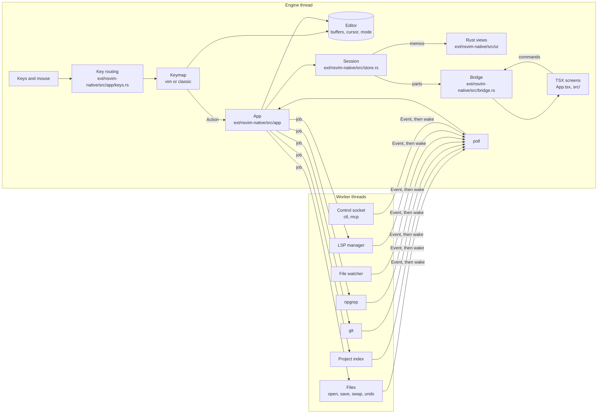

# How NsVim works

NsVim is a TSX app with its own Rust, in NSH's recommended layout. The **core**
(`crates/editor-core`, library `editor`) is the text and the rules for changing it. It knows
nothing about windows. The **app** (`ext/nsvim-native`, an nshm crate and the binary `nsvim`)
owns all app state, routes input to the core, and runs every slow job on a worker thread. The
**screens** (`App.tsx` and `src/`) show that state with [NSH](https://nsh.dev). NSH draws with the native views of each
platform: GTK 4 on Linux, AppKit on macOS and WinUI on Windows.



## The core: `crates/editor-core`

| Module | Holds |
| --- | --- |
| `buffer` | `Buffer`: a [ropey](https://docs.rs/ropey) rope, the path, line endings, grouped undo, named marks that move with edits, and the undo history kept across restarts. |
| `editor` | `Editor`: open documents, the active one, the mode, registers, the command line, search, options, and the `Action`s a keymap returns. |
| `vim` | The Neovim keymap: Normal, Insert, Replace, Visual and Command modes, operators, motions, text objects, Ex commands, search and a small regex engine. |
| `classic` | The classic keymap: no modes, Shift to select, Ctrl or ⌘ shortcuts, and multiple cursors. |
| `syntax` | Tree-sitter text objects and motions, and syntax colours from each grammar's highlight query, for 23 languages. |

A keymap is a function from a key to changes:

```rust
pub fn handle_key(ed: &mut Editor, key: KeyInput) -> Vec<Action>
```

It changes the text and the cursor directly. Anything outside the text, such as saving a file,
opening the finder or copying to the system clipboard, comes back as an `Action` for the app to
carry out. This split keeps the core free of I/O. Its tests run in milliseconds and need no
window.

Every edit goes through `Buffer`, inside a transaction:

```rust
buf.begin(cursor);
buf.remove(a, b);
buf.insert_at(a, "new text");
buf.commit(cursor); // one undo step, with the cursor before and after
```

An Insert session, a `:s` command, a paste at every cursor or a rename across a file is one
undo step.

## The app: `ext/nsvim-native`

| Path | Holds |
| --- | --- |
| `src/app` | `App`: the core `Editor`, the tree, overlays, Settings, setup, git and LSP state. Key routing, mouse handling, pickers and actions. Handlers record effects on a `Tx` (copy, read the clipboard, a menu, the title, quit, wake later). |
| `src/store.rs` | `Session`: `App` in a `stored` cell, a revision signal, and the effects runner. |
| `src/bridge.rs` | The join between `App` and the TSX screens: listeners and commands. |
| `src/exports` | What `App.tsx` imports from `nsvim-native`: components and modules. |
| `src/model.rs` | `frame`: what the text area shows, from the `Editor`. Plain Rust, with no NSH code. |
| `src/ui` | The views that Rust draws: the text area, the popups by the cursor, the diff review and the native context menu. Theme tokens (`src/ui/style.rs`). |
| `src/services` | The worker threads, each with a job channel in and an `Event` channel out. |
| `src/ipc` | The control socket protocol, and the `ctl` and `mcp` commands. |
| `config.rs`, `theme.rs` | `config.toml`, the 16 built-in palettes, and the Omarchy theme reader. |

## The screens: `App.tsx` and `src/`

`App.tsx` is the entry. `nsh.json` lists the app's Rust as a path dependency
(`"nsvim-native": { "path": "ext/nsvim-native" }`), and TSX imports it from `"nsvim-native"`.
`nsh.lock` records it. Rust owns all app state. TSX only shows parts of it and
asks Rust for changes.

| File | Shows |
| --- | --- |
| `App.tsx` | The window: setup, or the editor with Settings over it. |
| `src/buffer-line.tsx` | The tabs of the open files, and the project folder over the tree. |
| `src/tree.tsx` | The file tree. |
| `src/status-line.tsx`, `src/command-line.tsx` | The status line and the command line. |
| `src/overlays/` | The leader menu, the finder with its pickers, and the in-app context menu. |
| `src/settings/` | Settings, over the whole window. |
| `src/setup/` | First-launch setup. |
| `src/welcome.tsx` | The welcome page of a window with no project. |
| `src/controls.tsx`, `src/font.tsx` | Shared controls, and the interface font. |

`nsvim-native` exports these:

| Export | Kind | Does |
| --- | --- | --- |
| `Workspace` | component | Makes the session, sets the theme tokens, starts the workers and takes every key. The screens go inside it. |
| `TextArea` | component | The code, drawn by Rust. |
| `Icon` | component | A Lucide icon in the text colour. |
| `Shell` | module | What the window shows, `focusKeys`, and the close button. |
| `Overlays`, `FileTree`, `Tabs`, `Status`, `Cmdline`, `SettingsPage`, `SetupFlow`, `Welcome` | modules | The state of one area each, and the changes its clicks ask for. |

### The bridge

`ext/nsvim-native/src/bridge.rs` joins the two sides:

- `subscribe(part, listener)` gives a TSX listener a part of `App` (a `JsObject` struct) now,
  and again after each `Session::update` that changes it. TSX keeps the part in a signal.
- `send(command)` and `update(|app, tx| ...)` queue a change. The session runs it on the engine
  thread, through `Session::update`. Then the listeners hear what changed.

A module call from TSX runs outside the reactive runtime, so it never reads the session. Keep
each part small. Split a part when one field changes far more often than the rest: the status
line has the position as a part of its own.

### What stays in Rust

The text area, the popups by the cursor (completion and hover), the diff review of an agent's
proposal and the native context menu stay in Rust. They change on almost every key, or they
need the text area's geometry. A key must not wait for a trip through TSX.

### One change

NSH runs a component body once. After that, only the bindings that read a changed signal run
again. The app uses this in three steps:

1. Every change goes through `Session::update(|app, tx| ...)`. It changes `App`, bumps the
   revision signal, and then carries out the effects the handler recorded. Then the bridge
   posts each TSX part that changed.
2. Each Rust view reads only its part of `App`, through a memo (`Session::view(|app| part)`).
   The memo runs again after each update. Its readers run again only when the part changed.
3. The text area has one slot for each visible row. Each slot reads its own row of the frame,
   so a key rebuilds only the rows that changed. The caret is a view on top of the rows.

Syntax colours come from tree-sitter highlight queries. They run only over the lines on screen.
Scrolling is the editor's own (`view.top`), not a scroll view, because the cursor and
`scrolloff` decide what shows.

### Input

One view takes every key (`capture_keys(KeyCapture::All)` in `Workspace`, `src/exports/workspace.rs`) and gives it to
`App::key`. The key goes to the first of these that wants it:

1. First-launch setup.
2. Settings, while it shows. It covers the whole window.
3. An open overlay: the leader menu, a picker, the context menu.
4. The command line (`:`, `/`, `?`).
5. A hover or completion popup.
6. The file tree, when it has focus.
7. The active keymap.

The text area measures one character of the code font. The mouse code maps a point to a line
and a column from that width, and counts tabs and wide characters.

### Workers

Workers never touch app state. Each gets jobs on a channel and sends `Event`s back. Then it
calls a waker. The waker sends on a channel that a task on the engine thread awaits, and that
task polls the app. Events arrive while the window is hidden, covered or minimized, so an
agent's request or a file reload never waits for you to look.

| Worker | Does |
| --- | --- |
| `editor-io` | Opens files (with `.editorconfig`, a stored undo history and crash recovery), writes saves atomically, writes swap files and undo histories, reads previews. |
| `editor-index` | Walks the project with git's ignore rules, for the finder and the tree, and walks it again when files come or go. |
| `editor-git` | Reads the branch and file status, and diffs each buffer against `HEAD` for the gutter. |
| `editor-grep` | Runs `rg --vimgrep`, or a plain walk when ripgrep is missing. |
| `editor-watch` | Watches the project, open files outside it, `config.toml` and Omarchy's theme folder. |
| `editor-lsp` | Starts language servers, keeps documents in step, and turns answers into events. |
| `editor-probe` | Finds facts the setup needs: this program's path, `$PATH`, free command names, the Neovim leader. |
| `editor-ipc` | Serves the project's control socket for the `ctl` and `mcp` commands and agents. See [agents.md](agents.md). |

A save shows the pattern. The engine thread trims the text as one undo step and takes its
bytes. The file worker writes them to a temporary file and renames it over the old one. The
`Saved` event then marks that buffer version clean. The UI never waits on the disk.

## Release layout and the dev loop

A release is the `nsvim` binary and its interface, `nsh/bundle.nshc`, in a folder next to it.
`nsh build --release` compiles `App.tsx` and `src/` to that bytecode. On macOS the interface is
in the app bundle, in `NsVim.app/Contents/Resources/nsh/`. See [install.md](install.md).

In development:

| Command | Does |
| --- | --- |
| `nsh run` | Runs the app in a window. TSX edits apply at once. Rust edits rebuild and restart it. |
| `nsh check` | Checks the crate, writes the TS types of `nsvim-native` to `.nsh/types`, and type-checks the TSX. |
| `nsh build` | Builds the crate and bundles the TSX. Read its warnings: unknown classes, exports without docs. |
| `nsh test` | Runs `cargo test`, then any `*.test.tsx`. |

## State on disk

| Path (Linux) | Holds |
| --- | --- |
| `~/.config/nsvim/config.toml` | Settings. |
| `~/.local/state/nsvim/sessions/` | Open files and cursor positions, per project. |
| `~/.local/state/nsvim/undo/` | Undo histories of saved files. |
| `~/.local/state/nsvim/swap/` | Unsaved text, for crash recovery. |
| `~/.local/state/nsvim/window.toml` | The window's last size and position. |

NsVim copies the files of an older `editor` folder into these folders once, on the first start.
